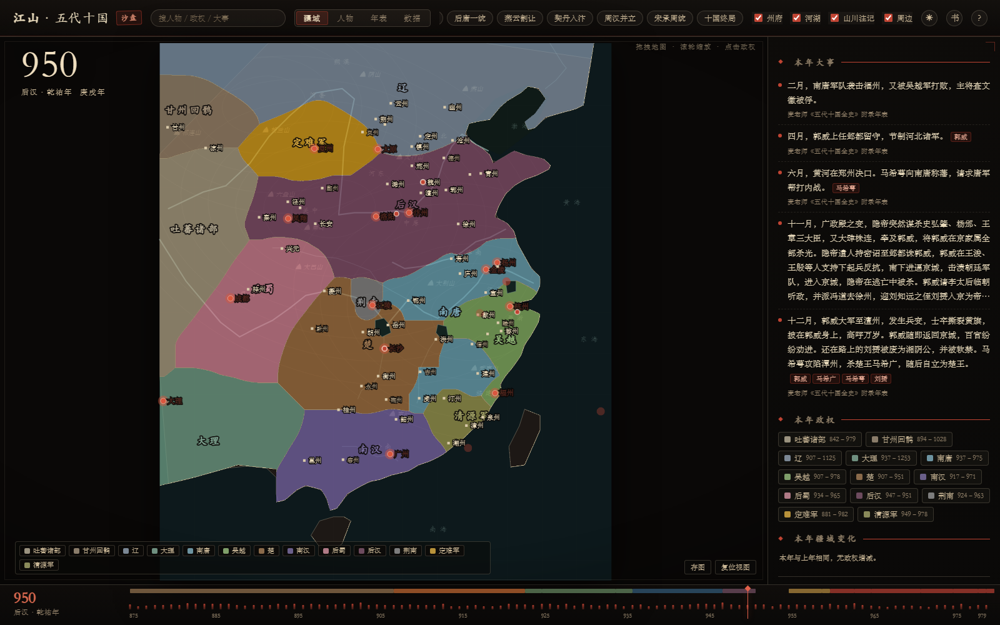

# 江山 · 五代十国疆域时序（875–979）



> **主题**：默认「沙盘」深色主题（军帐推演感）；右上角 ◐ 可切换「史册」浅色主题。

**在线访问**：<https://jiangchengzhi-ai.github.io/FiveTen/>　（GitHub Pages，由 `gh-pages` 分支发布）

> 纯静态、离线可开的五代十国交互式历史地图：时间轴 + 逐年疆域 + 人物关系 + 大事年表 + 书稿章节导航。
> 打开方式：双击 `index.html`，或访问 <https://jiangchengzhi-ai.github.io/FiveTen/>。

> 交付总览、验证记录与已知限制见 [交付说明.md](交付说明.md)。
> 数据来源与版权声明见 [NOTICE.md](NOTICE.md)。　与参考项目《江山时序》的逐项对比见 [对比-江山时序.md](对比-江山时序.md)。

仿照 [DeanChensj/jiangshan-map](https://github.com/DeanChensj/jiangshan-map)（江山时序）的做法，自建的**五代十国交互式疆域地图**：一条时间轴走完 907–979，逐年看政权兴替、疆域伸缩、都城与人物结局。

纯静态站点，无构建、无后端、无外部依赖，双击 `index.html` 即可离线打开。


## 现在有什么

- **连续时间轴 907–979**：拖动、点击刻度、键盘 ←/→、▶ 播放（遇大事年自动停顿）。
- **疆域按年代生效**：每个政权有多段"疆域时期"，跨过改元、灭国、割地的年份自动切换，不是一张张静态图。
- **626 件大事（875–979 每年都有条目，逐条标注史源）**：按年挂在时间轴上（菱形标记），右侧显示本年事件；点击标记跳转。
- **30 个政权**：五代（梁唐晋汉周）、十国（吴、南唐、吴越、闽、楚、南汉、前蜀、后蜀、荆南、北汉）、割据（晋、岐、燕、湖南、清源军、清海军、定难军）、云南诸国（大长和、大天兴、大义宁、大理）、周边（辽、吐蕃诸部、甘州回鹘）。
- **人物与结局**：点政权 → 君主世系表、在位年、每人结局一句话；点君主行可直接跳到该年。
- **章节导航**：顶栏「书」按钮（或按 `B`）打开麦老师八部 78 章目录，点章节跳到该章对应年份（约数）。
- **时间轴 875–979**：起点前移到 875（黄巢起义），新增唐（875–907，底色）与大齐（880–884）两个政权，分期色带与改朝标记同步。
- **大事年表来自书稿**：626 条大事按麦老师《五代十国全史》附录年表重建（875–979 全覆盖，逐年有月份），旧的正史条目备份在 `research/旧大事-165.json`。
- **事件↔人物、政权↔人物互链**：侧栏每条大事下方自动列出文中提到的人物标签；点开政权详情会列出该政权收录的全部人物，点击即进人物生平。
- **中原王朝分期带**：底部时间轴上方一条色带，按梁→唐→晋→汉→周→宋分色，标出 923/936/947/951/960 五个改朝换代点，点色带即跳到该朝元年。
- **交互修正**：hover/点击改为按**像素分区**命中，和看到的填色完全对齐；选中政权描朱边、其余压暗。
- **地名**：州府 37 → 70，主要州府常显、小地名随缩放隐藏，并做标签避让。
- **观感**：疆域/海岸线做角切平滑，填色更实，政权名与州府字号加大。
- **大事折叠**：侧栏长条目默认 6 行，点击展开。
- **清晰边界**：疆域改为「像素级归属 + 统一描边」——相邻政权无缝隙、无重叠混色，边界线连续；海岸线与湖面单独描边/置顶。
- **疆域逐年差异**：拖动年份时自动与上一年对比，本年新出现的政权描红边闪烁，侧栏列出「新出现 / 退出」政权，可点击查看。
- **人物生平时间线**：选中人物后，侧栏按年列出「出场 → 关系结成/终结 → 相关大事 → 结局」，可一眼看完一个人的一生轨迹。
- **人物视图（第二个标签页）**：185 位人物、326 条关系（全部带精确起止年）。圆点＝人物（按政权分簇着色），连线＝父子/兄弟/祖孙/叔侄/姻亲/君臣/敌对/弑杀/赐死/废黜/逼禅/出降；时间轴一拖，人物按"活跃期"进出画面（生年 ≠ 出场年，避免把幼童画进来）；侧栏实时给出「本年结局」与「本年关系变化」——新出现的关系画粗线、中断的关系划掉，能看出关系网逐年长出来又断掉。
- **性格与结局统计**：每人 2–3 个性格标签（枭雄/暴虐/多疑/宽厚/寡断/文采/昏懦……），结局分「暴力而终 / 失权而终 / 病卒善终」三类并给出细分计数与本年结局明细。
- **年表视图（第三个标签页）**：30 个政权的寿命横条按建国先后排列，一眼看出谁先亡、谁与谁并存；顶部大事菱形可点，点横条跳到建国年，点空白按 x 位置跳年；侧栏列「本年存续」与全部政权亡因。
- **数据视图（第四个标签页）**：规模概览（政权/疆域段/大事/人物/关系/年份）、9 项完整性自检（事件年份、年度覆盖、史源、活跃期、关系悬空、起止年、结局年、疆域指向）、每十年大事数、政权寿命 Top 10、人物结局分布、关系类型分布。
- **帮助面板**：右上角 `?`（或按 `?` 键）打开用法、数据规模、口径与版本说明；`1–4` 切视图、`空格` 播放、`← →` 逐年、`Esc` 关闭。
- **全局搜索**：顶栏搜「人物 / 政权 / 大事 / 州府」，命中后直接切视图、跳年份并选中对象；支持 ↑↓ 选择、回车确认。
- **可分享链接**：地址栏会同步为 `#view=people&year=950` 这类形式，复制即跳到同一视图与年份。
- **导出与打印**：地图左下「存图」把当前视图导出为 2× PNG（内联样式、离线栅格化）；`Ctrl+P` 打印时自动隐藏顶栏/侧栏/时间轴，只留地图或当前视图。
- **响应式**：桌面/平板左右分栏，手机单栏＋时间轴吸底；顶栏在窄屏自动收拢（隐藏分幕按钮、品牌缩为「江山」）。
- **地图交互**：滚轮缩放、拖拽平移、政权高亮、悬浮提示、图层开关（州府/河湖/山川注记/周边）。
- **年号**：显示中原王朝年号（开平、同光、天福、显德、太平兴国……）与干支。

## 目录结构

```
index.html            入口
css/atlas.css         宋画绢本风格样式
js/geo.js             底图：海岸线、河流、湖泊、山脉注记（简化示意）
js/data.js            政权、君主、疆域多边形、大事、年号、州府
js/territories.js     疆域补丁：宋/后周的连续疆域拼合、清源军
js/people.js          人物档案（性格标签、结局）与关系三元组
js/people-view.js     人物视图：关系网络、结局统计、时间联动
js/chrono-view.js     年表视图：政权寿命条（Gantt）与大事年刻
js/stats-view.js      数据视图：完整性自检与分布统计
js/book-chapters.js   书稿章节 → 年份映射（自动生成）
js/book.js            章节导航面板
js/help.js            帮助/关于面板与键盘快捷键
js/export.js          导出 PNG（SVG 序列化 + canvas 栅格化）
js/search.js          全局搜索：人物 / 政权 / 大事 / 州府
js/app.js             渲染、时间轴、交互
preview/              各年份截图
research/史料与口径.md 史料来源、取舍与待办
```

## 数据模型（改数据只用改 js/data.js）

```js
regimes: [{ id, name, full, color, type, capital, founded:{year,by}, ended:{year,how},
            summary, rulers:[{name,years,note}], sources:[] }]
territories: [{ regime, from, to, z, polys: [[[lon,lat],...], ...] }]   // from ≤ 年 < to
events: [{ year, text, place:[lon,lat] }]
eras: [{ regime, name, from, to }]
cities: [{ name, alt, lon, lat, type:'capital'|'seat', note }]
```

- 多边形用经纬度（图幅 100–126°E，17–43°N），改边界就是改坐标。
- 同一政权可以有多个 `territories` 段；渲染时同政权会合成一条 path，重叠处不叠色、不留缝。
- 新增政权：`regimes` 加一条 + `territories` 加若干段，刷新即可。

人物（js/people.js）：

```js
PEOPLE: [{ id, n:'姓名', r:'政权id', role:'身份', a:[起始年,卒年],
           tags:['性格','标签'], end:['结局类型', 年份, '说明'], note:'一句评' }]
RELATIONS: [['甲id','乙id','关系类型']]   // 父子 兄弟 祖孙 叔侄 姻亲 君臣 敌对 弑杀 赐死 废黜 逼禅 出降
```

- 人物视图按 `a` 区间过滤：只要与当前年份有交集就显示，所以拖时间轴能看到人物一代代更替。
- 结局类型决定侧栏的「暴力而终 / 失权而终 / 病卒善终」归类与统计；新增类型只需加进 `ENDING_GROUPS`。

## 史料与口径

以《旧五代史》《新五代史》《资治通鉴》《十国春秋》《辽史》《宋史》为骨架，疆域分期参考谭其骧《中国历史地图集》五代十国卷。

**注意**：多边形是人工绘制的**示意性简化边界**，不是精确测绘，也不代表任何现代行政主张。势力交错、羁縻、短时段反复争夺的地区（如淮南、燕云、河西）按主要归属取整。详见 [research/史料与口径.md](research/史料与口径.md)。

## 已知待办

1. 人物扩到 120+：补后梁/后唐宗室、十国第二代、辽与宋初将领；关系补全（尤其姻亲与敌对链）。
2. 大事再补到 150 条，并逐条核对到具体卷次（现 120 条，标到纪/传一级）。
3. 大事再补到 100+ 条；短命割据（如大天兴）已补入。
4. 年表视图加"同期对照"（把同年建立/灭亡的政权高亮成组）。
5. 对齐麦老师《五代十国全史》的分期与叙事（等书稿）。
6. 更细的州级边界与更多州府点位。

## 许可

自建代码，可自由使用；**参考项目 jiangshan-map 为 GPL-3.0，本仓库未复制其代码与数据**，仅借鉴"时间轴 + 疆域快照 + 信息栏"的产品思路。

## 部署（GitHub Pages）

本仓库用 GitHub Pages 发布，源分支是 **gh-pages**（与 main 内容一致）：

```bash
# 更新时两次推送即可
git push origin main
git push origin main:gh-pages
```

Pages 设置：Settings → Pages → Source: Deploy from a branch → `gh-pages` → `/ (root)`。
如果想改成从 `main` 发布，在 Settings → Pages 里切换分支再保存即可（本仓库的 token 无 Pages 权限，未自动切换）。
